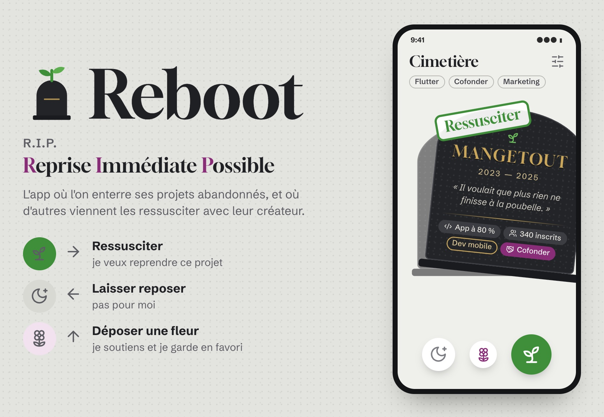

# Reboot

**R.I.P. — Reprise Immédiate Possible.**

L'app où l'on enterre ses projets abandonnés, et où d'autres viennent les ressusciter avec leur créateur :
on swipe des pierres tombales comme sur Tinder (ressusciter, laisser reposer, déposer une fleur), et un match
à double sens ouvre une veillée de 14 jours qui mène au pacte de reprise.

- `plan/` : le plan illustré (planches générées par `plan/build.mjs`)
- `JOURNAL.md` : le journal de bord de la création, étape par étape

Icônes : [Lucide](https://lucide.dev) (licence ISC).
